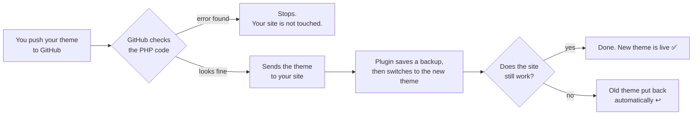

# WordPress Git Auto Deploy

[](https://github.com/vibhorashopifyagency/wordpress-git-auto-deploy/actions/workflows/ci.yml)
[](https://github.com/vibhorashopifyagency/wordpress-git-auto-deploy/releases/latest)
[](LICENSE)

**Update your live WordPress theme just by pushing your code to GitHub.
If the update breaks your site, the old version comes back by itself.**

Free and open source. Works on ordinary shared hosting (cPanel). No FTP, no SSH, no terminal needed.

---

## What it does

**Without this tool**, updating a theme usually means: zip the theme, log in to cPanel, upload
it, unzip it, and hope nothing broke.

**With this tool**, you push your code to GitHub. About a minute later the new theme is live on
your site. If the new code breaks the home page, the previous version is put back
automatically.



It only changes your **theme files**. Your posts, pages, orders, users and settings are never
touched.

## What you need

- A WordPress site (version 6.4 or newer) where you can install plugins, running PHP 8.0 or
  newer. Normal cPanel shared hosting is fine.
- Your theme's code in a GitHub repository. Public or private, both work.
- Admin access to the WordPress site and to the repository's settings on GitHub.

That's all. You can do the whole setup in your web browser.

<details>
<summary><b>New to Git or GitHub? Click here for the words used in this guide.</b></summary>

| Word | What it means |
| --- | --- |
| **Repository (repo)** | A project folder on GitHub that keeps your code and its history. |
| **Commit** | A saved snapshot of your changes, with a short message. |
| **Push** | Sending your commits from your computer to GitHub. |
| **Branch** | A separate line of work. `main` is usually the one that goes live. |
| **GitHub Actions / workflow** | A list of steps GitHub runs for you automatically, for example after each push. |
| **Secret** | A private value (like a password) stored in GitHub's settings. It is hidden in logs. |
| **Theme folder** | The folder name of your theme inside `wp-content/themes/`, for example `my-theme`. |
| **Rollback** | Putting the previous version back. |

More words are explained in the [glossary](docs/glossary.md).
</details>

### Prefer to let an AI assistant set it up?

Give your AI assistant (ChatGPT, Claude, Copilot, Cursor, Codex…) this message:

```text
Set up WordPress Git Auto Deploy for my WordPress theme by following
https://github.com/vibhorashopifyagency/wordpress-git-auto-deploy/blob/main/docs/ai-setup.md
Ask me for anything you need, one step at a time.
Never ask me to paste the deploy secret into this chat.
```

What it can do for you, and what you'll still do yourself: [AI setup](docs/ai-setup.md).
**AI assistants reading this:** follow [docs/ai-setup.md](docs/ai-setup.md).

## Setup in 5 steps (about 15 minutes)

### Step 1. Install the plugin on your site

1. Download **`git-auto-deploy.zip`** from the [latest release](https://github.com/vibhorashopifyagency/wordpress-git-auto-deploy/releases/latest).
2. In WordPress go to **Plugins → Add New Plugin → Upload Plugin**, choose the zip, click
   **Install Now**, then **Activate Plugin**.

### Step 2. Check the plugin's page

Go to **Tools → Git Auto Deploy**.

- Under **Server checks**, every row should have a green tick ✅.
  If one has a red cross ❌, see [Troubleshooting](docs/troubleshooting.md).
- Note the **Theme folder** name shown there (for example `my-theme`). You need it in step 4.
  By default the plugin updates the theme that is active on your site.

### Step 3. Add two secrets to your GitHub repository

In your theme's repository on GitHub, go to **Settings → Secrets and variables → Actions →
New repository secret**, and add these two:

| Name (type exactly) | Value |
| --- | --- |
| `GIT_AUTO_DEPLOY_URL` | Your site address, copied from WordPress **Settings → General → Site Address (URL)**, for example `https://example.com` |
| `GIT_AUTO_DEPLOY_SECRET` | The secret from **Tools → Git Auto Deploy → Connect GitHub → Show secret** (64 characters) |

### Step 4. Add the deploy workflow to your repository

You add two files to your theme's repository. Do this for each file in the table below:

1. Open the file from this project (links below) and click the **Copy raw file** button
   (the two-squares icon at the top right of the file).
2. In **your** repository on GitHub, click **Add file → Create new file**.
3. In the file name box, type the path from the table. (Typing `/` creates the folders.)
4. Paste, then click **Commit changes**.

| Copy this file | Create it in your repository as |
| --- | --- |
| [`workflow/deploy-theme.yml`](workflow/deploy-theme.yml) | `.github/workflows/deploy-theme.yml` |
| [`workflow/git-auto-deploy.sh`](workflow/git-auto-deploy.sh) | `.github/scripts/git-auto-deploy.sh` |

Before you commit `deploy-theme.yml`, change the lines marked `CHANGE`. Pick the example that
matches your repository:

<table>
<tr><th>My repository <i>is</i> the theme<br/>(style.css is at the top)</th><th>My repository holds the whole site<br/>(theme is in a subfolder)</th></tr>
<tr><td>

```yaml
    paths:
      - '**'
...
      THEME_SLUG: my-theme
      THEME_DIR: .
      SMOKE_PATHS: / /contact/
      PHP_VERSION: '8.2'
```

</td><td>

```yaml
    paths:
      - 'wp-content/themes/my-theme/**'
...
      THEME_SLUG: my-theme
      THEME_DIR: wp-content/themes/my-theme
      SMOKE_PATHS: / /contact/
      PHP_VERSION: '8.2'
```

</td></tr>
</table>

- **`THEME_SLUG`**: the theme folder name from step 2.
- **`SMOKE_PATHS`**: a few pages of your site that must load after every update, separated by
  spaces. Only use pages that will not be moved or deleted.
- **`PHP_VERSION`**: your server's PHP version (cPanel → MultiPHP Manager).

More options, and a faster way using the terminal, are in the [setup guide](docs/setup-guide.md).

### Step 5. Run the first deploy

In your repository, go to **Actions → Deploy theme → Run workflow → Run workflow**.
Wait about a minute. A green tick means your theme is live. 🎉

From now on, **every push to `main` that changes the theme goes live by itself.**

## Using it every day

1. Change your theme, commit, and push to `main`.
2. Watch the **Actions** tab on GitHub: green ✅ means it's live, red ❌ means it stopped (and
   your site was kept safe).
3. See the history in WordPress under **Tools → Git Auto Deploy → Activity**.

**Need to undo an update?** Go to **Tools → Git Auto Deploy → Earlier versions** and click
**Roll back to this**. Then fix the code in Git too, otherwise your next push sends the same
change again.

More: [everyday use, rolling back and manual uploads](docs/everyday-use.md).

## If something goes wrong

| What you see | What to do |
| --- | --- |
| The workflow did not start after a push | Your push did not change files inside `THEME_DIR`, or went to another branch. Run it by hand: **Actions → Deploy theme → Run workflow**. |
| "Nothing was deployed: add the … secrets" | A secret is missing or misspelt. Check step 3. |
| "Lint theme PHP" failed | Your PHP has a syntax error. The log shows the file and line. Your site was not touched. |
| HTTP 401 "Bad signature" | The secret on GitHub does not match the one in WordPress. Copy it again (step 3). |
| HTTP 404 | The plugin is not active, or `GIT_AUTO_DEPLOY_URL` is wrong. |
| The deploy is green but the site looks old | A cache is showing the old page. Clear your cache plugin, Cloudflare or browser cache. |

Everything else: [Troubleshooting](docs/troubleshooting.md).

## Questions

**Will it change my posts, pages or settings?**
No. It only replaces the files of one theme folder. The database is never touched.

**What if I push broken code?**
PHP syntax errors are caught on GitHub before anything is sent. If the new theme still breaks
the site, the old version is put back automatically within seconds.

**Does it work with a private repository?**
Yes, for free. Your site never connects to GitHub, so it needs no GitHub password or token.

**Do I need cPanel?**
No. It works on any host where WordPress can write to its `wp-content` folder. It was built for
and tested on cPanel shared hosting.

**Can it update plugins too?**
No, it updates one theme. See [what it does not do](docs/how-it-works.md#what-it-does-not-do).

**Is it safe?**
Every update is signed with a secret that only your site and your GitHub repository know.
Details: [Security](docs/how-it-works.md#security).

## What's in this project

```text
wordpress-git-auto-deploy/
├── plugin/           The WordPress plugin. You don't need this folder:
│                     download the ready-made zip from Releases instead.
├── workflow/         The 2 files you copy into your theme's repository (step 4).
├── docs/             Detailed guides: setup, everyday use, troubleshooting, reference.
├── tests/            Automated tests. Only needed if you change the code.
├── .github/          This project's own automatic checks.
├── CHANGELOG.md      What changed in each version.
├── CONTRIBUTING.md   How to help improve this project.
├── SECURITY.md       How to report a security problem privately.
├── AGENTS.md         Short instructions for AI coding agents.
├── llms.txt          A summary with links, for AI assistants.
└── LICENSE           GPL-2.0-or-later, the same license as WordPress.
```

## Guides

| Guide | Read it when you want to… |
| --- | --- |
| [Setup guide](docs/setup-guide.md) | set it up with every option explained |
| [Everyday use](docs/everyday-use.md) | deploy, roll back, or upload a zip by hand |
| [Troubleshooting](docs/troubleshooting.md) | fix an error message |
| [How it works](docs/how-it-works.md) | understand each step, security, and how it compares with other tools |
| [Reference](docs/reference.md) | look up settings, hooks, the API, and files it keeps |
| [Glossary](docs/glossary.md) | understand a word used in these guides |

## Contributing

Found a bug or have an idea? [Open an issue](https://github.com/vibhorashopifyagency/wordpress-git-auto-deploy/issues).
Want to change the code? Read [CONTRIBUTING.md](CONTRIBUTING.md).
Found a security problem? Please report it privately, as [SECURITY.md](SECURITY.md) explains.

## License

GPL-2.0-or-later, the same license as WordPress. See [LICENSE](LICENSE).
Copyright © 2026 Vibhora Inc.
